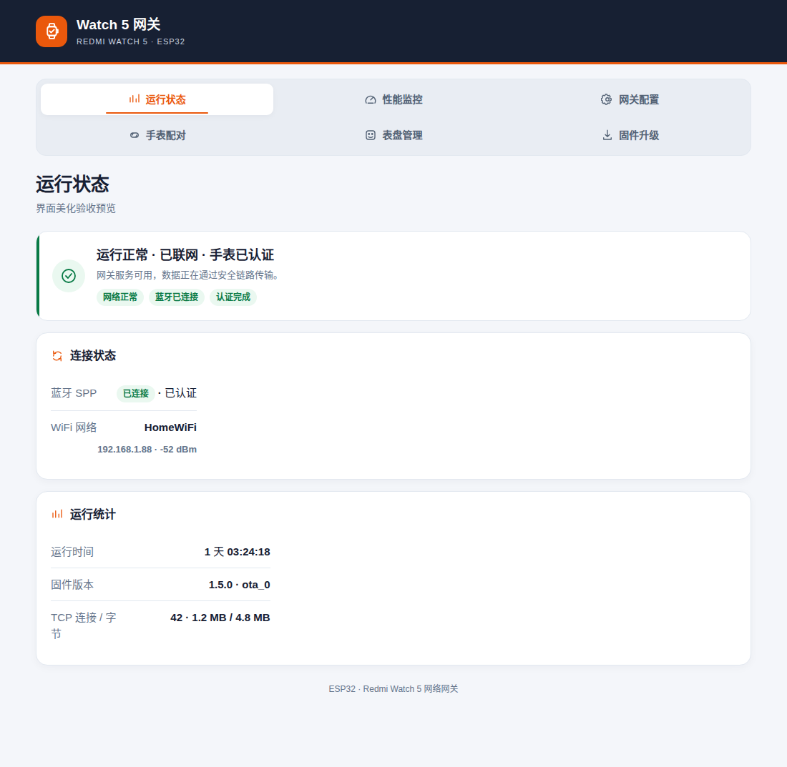
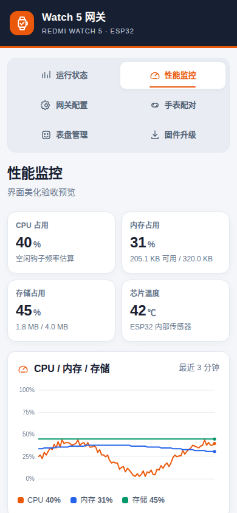
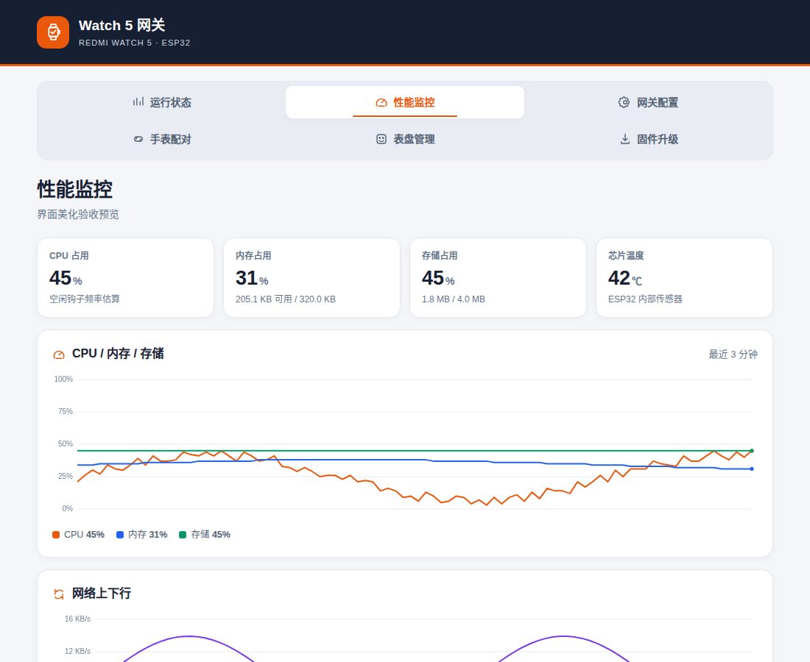
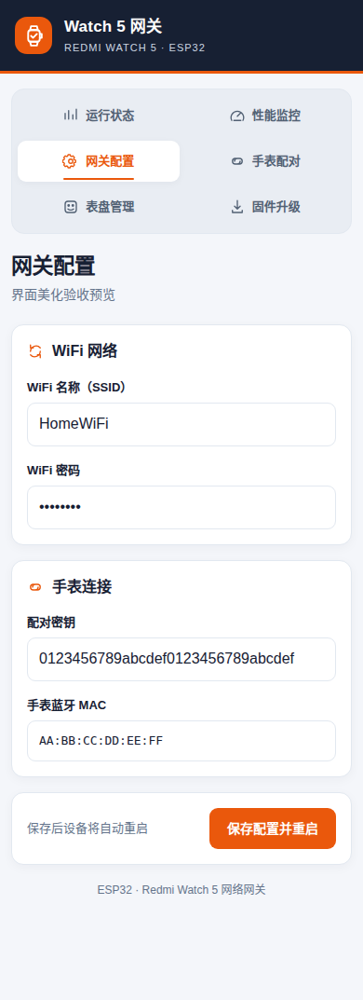
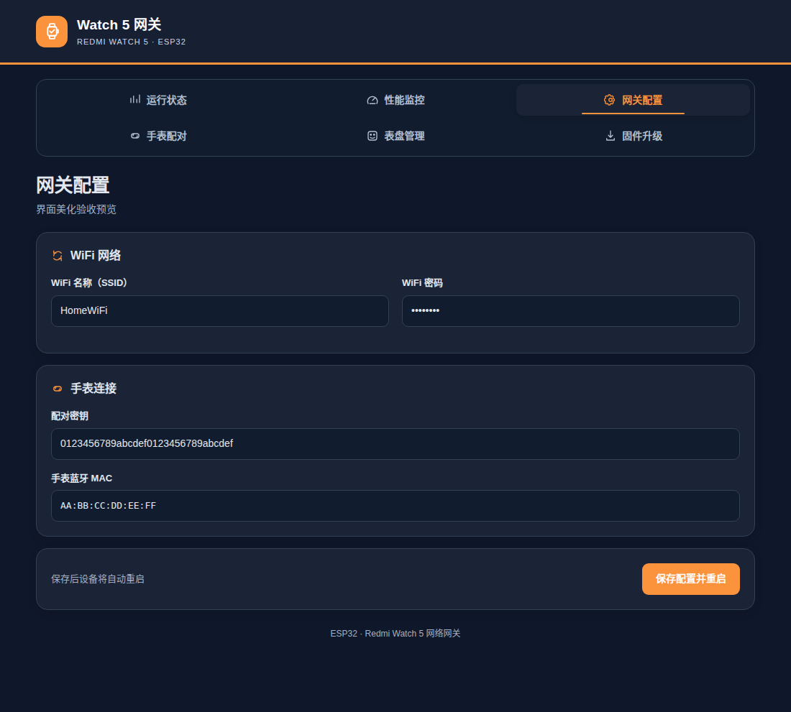

# Web 管理页面 UI 美化计划

本文针对当前固件内置的 Web 管理界面（`/` `/perf` `/config` `/pair` `/watchface` `/firmware`），
列出实测发现的界面问题与分阶段改进方案。

约束前提（决定方案边界，不可忽略）：

- 页面由 ESP32 在运行时拼接生成，**不能引入构建工具链**（无 npm / 打包 / 预处理器）
- 单页 HTML 已接近 10KB，**不能引入外部 CSS/JS 依赖**（设备常在无外网的配网环境）
- 浏览器多为手机（iOS Safari / Android Chrome），**移动端优先**
- 所有资源必须能从 Flash 直接发出，**字体只能用系统字体栈**

## 零、实施结果（v1.5.0 实测截图）

U1–U10 已全部完成并发布到 v1.5.0。完整截图位于 `docs/preview/ui-v1.5-*`，
包含六个页面在 1100px 桌面与 390px 手机下的效果、性能页和配置页深色模式、
配置表单就地错误提示。

| 桌面（1100px） | 手机（390px） |
| --- | --- |
|  |  |
|  |  |
|  |  |

截图由 Chromium 实际渲染本项目页面得到（性能数据为模拟采样，仅用于核对排版）。
浏览器自动化已检查六页在两个视口下无横向溢出、无 JavaScript 错误，深色模式图表颜色正确。

---

## 一、现状问题清单（实测）

| 编号 | 问题 | 证据 / 位置 | 影响 |
| --- | --- | --- | --- |
| U1 | 导航 6 项在 960px 容器里偏挤，移动端 2 列排布后第 3 行只有 2 项，底部留白不齐 | `webui.cpp` nav 样式 | 视觉不平衡，点击区偏窄 |
| U2 | 状态页 6 张卡片平铺，主次不分：连接状态与"运行统计"视觉权重相同 | `_handleRoot` | 用户第一眼抓不到"能不能用" |
| U3 | 颜色语义不统一：品牌橙既作强调又作主按钮，图表另用 6 种色；`bad` 红与 `danger-zone` 红混用 | CSS `--brand` / 图表色 | 同一颜色表达了不同含义 |
| U4 | 没有深色模式，夜间/手机暗色环境下白底刺眼 | 全局 | 夜间使用体验差 |
| U5 | 表单校验反馈缺失：保存失败只返回 `409` 纯文本，用户被带到白页 | `_handleSave` / `_handleReboot` | 出错时无引导 |
| U6 | 移动端表格横向滚动（配对页、表盘页），关键列被挤出视口 | `.table-wrap` | 需要横向拖动才能看全 |
| U7 | 数字指标刷新时无过渡，2 秒轮询会让数字"跳变" | `/perf`、悬浮条 | 观感抖动 |
| U8 | 全站图标用文字（"W5"、"×"），无视觉识别符号 | 全局 | 缺少专业感 |
| U9 | 没有加载态；进入表盘页时列表为空，先显示"尚未获取"再突然出现 | `_handleWatchface` | 观感像出错 |
| U10 | 无打印样式，用户若打印配置页会带出深色页头与阴影 | 全局 | 打印不可用 |

---

## 二、设计原则（先定规则再改样式）

1. **一个主色**：品牌橙 `#ea580c` 只用于"主要操作 + 当前导航"。状态色独立成体系：
   - 正常 `#087a45`（绿）、注意 `#b45309`（琥珀）、异常 `#b42318`（红）、中性 `#526174`（灰）
2. **信息分层**：每页只允许一个"主卡片"承载结论（能不能用），其余为支撑信息。
3. **移动端优先**：所有交互元素 ≥ 44×44px；表格在 <600px 时降级为键值卡片。
4. **零外部依赖**：CSS 内联、图标用内联 SVG、图表用 Canvas。
5. **渐进增强**：`prefers-color-scheme` 与 `prefers-reduced-motion` 都做，不支持则退回基础样式。

---

## 三、分阶段计划

### P0 —— 一致性与可用性修复（预计改动集中在 CSS，风险低）

| 项 | 动作 | 验收标准 |
| --- | --- | --- |
| U1 | 导航改为 `grid-template-columns: repeat(3, 1fr)`，移动端 2 列；当前项加底部橙色指示条 | 6 项在 360px 宽度下两行排满，无孤项 |
| U3 | 抽出 `--ok / --warn / --bad / --neutral` 四个变量，替换散落的硬编码色值 | 全站状态色只用这四个变量 |
| U5 | 保存/重启失败改为返回带样式的错误页（含"返回配置"按钮），不再是纯文本 | 人为触发 409 时页面仍有导航与返回入口 |
| U7 | 数字加 `transition: color .2s`，数值变化不做位移动画 | 轮询刷新时无跳动，仅有颜色/数值更新 |
| U10 | 增加 `@media print`：隐藏 nav、悬浮条、按钮，去阴影 | 打印预览只有标题与键值表 |

### P1 —— 结构与视觉提升（改动涉及页面拼接逻辑）

| 项 | 动作 | 验收标准 |
| --- | --- | --- |
| U2 | 状态页顶部改为"结论条"：一句话总结（如"运行正常 · 已联网 · 手表已认证"），下面才是明细卡片 | 首屏 200px 内能判断设备是否可用 |
| U6 | <600px 时表格转卡片：`thead` 隐藏，每行变成"字段名 / 值"两列 | 配对页无需横向滚动即可看到 MAC 与操作按钮 |
| U8 | 导航与卡片标题加 12 个内联 SVG 图标（约 1.5KB） | 图标与文字基线对齐，深色模式自动反色 |
| U9 | 表盘页无数据时显示骨架行（灰条）而非"尚未获取"文字 | 首次进入不出现"错误感"文案 |

### P2 —— 主题与细节（可选，视 Flash 余量）

| 项 | 动作 | 验收标准 |
| --- | --- | --- |
| U4 | 用 `prefers-color-scheme: dark` 覆盖一组变量（背景 `#0f172a`、卡片 `#1a2436`、文字 `#e2e8f0`） | 系统切暗色后页面自动跟随，对比度 ≥ 4.5:1 |
| — | 图表配色随主题切换（Canvas 内读取 CSS 变量） | 暗色下网格线与文字仍可读 |
| — | 悬浮占用条支持"贴边吸附"：拖到左右边缘后记住位置（localStorage） | 刷新后位置保持 |
| — | 表单输入实时校验（密钥必须 32 位 hex、IP 格式），错误在字段下方就地提示 | 非法输入不触发提交 |

---

## 四、实施顺序与风险

1. **先 P0**：只改 CSS 与两个错误页，不动业务逻辑，回归成本最低。
2. **再 P1**：涉及 `_handleRoot` 与表格渲染函数，需同步更新 `tests/` 中若有的 HTML 断言
   （当前无 HTML 断言，但改完需人工截图核对 6 个页面）。
3. **最后 P2**：深色模式需检查 Canvas 图表在暗色下的可读性，
   悬浮条持久化会写 localStorage，需确认不影响 `file://` 之外的普通 HTTP 场景。

**Flash 预算**：最终应用区增加至 1.81MB（45.1%），仍远低于 4MB 单槽上限，余量充足。

**验收方式**：每个阶段用 Chromium 在 390×844（手机）与 1100×900（桌面）两个视口截图核对，
再检查一遍 `prefers-color-scheme: dark` 与打印预览。
